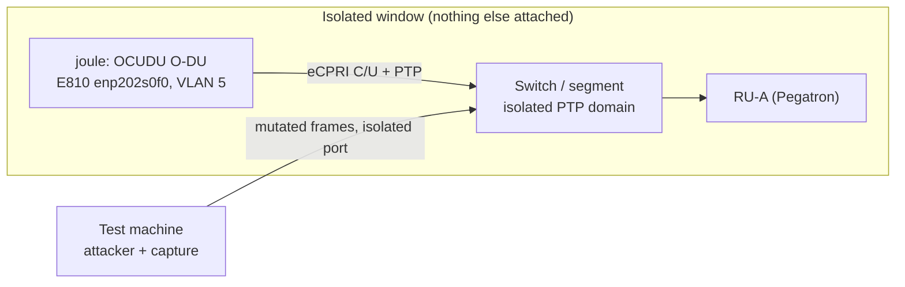

<h1 align="center">Open Fronthaul security test run (O-DU to O-RU on Ravi's platform)</h1>

> Skeleton for Sani, in the bmw SOP implementation-guide format
> ([example](https://github.com/petrajoyd/intern_repo/blob/main/docs/EXAMPLE_SOP_Guide_Format.md)).
> Fill the command blocks and outputs as you do the real hands-on run. The point is that anyone can
> reproduce it: you are the first to connect the O-DU to the O-RU and run security tests on top, and
> this document is what the next student copies. Keep secret values out of Git, list pointers only.
> No em dashes (bmw writing rule).

## Table of Contents

- [Scope and DUT](#scope-and-dut)
- [Rules of engagement and safety](#rules-of-engagement-and-safety)
- [Prerequisites](#prerequisites)
- [Project Root](#project-root)
- [Project Description](#project-description)
- [System Architecture](#system-architecture)
- [Access Method](#access-method)
- [Bring-up steps](#bring-up-steps)
- [Post-bring-up verification](#post-bring-up-verification)
- [Test execution and results](#test-execution-and-results)
- [Findings](#findings)
- [Known Issues](#known-issues)
- [Troubleshooting](#troubleshooting)
- [Additional Resources](#additional-resources)

## Scope and DUT

**In scope (WG11 STS §11.1, against the real O-DU and O-RU):**
- §11.1.2 LAN segment / 802.1X port access
- §11.1.4 U-plane input validation and robustness
- §11.1.5 S-plane (PTP) robustness

**Out of scope:** §11.1.3 M-plane (dropped per Joy, do not spend time on it).

**DUT (device under test):** OCUDU monolithic O-DU on joule, over the fronthaul to the Pegatron O-RU
(RU-A). Anchors: WG11 STS R005 v13.00 §11.1; method in
Joy's lab threat model (private lab repo) §7; bench results in
[`COVERAGE.md`](https://github.com/bmw-ntust-internship/internship/blob/2026-TEEP-Sani/lab/results/COVERAGE.md).

## Rules of engagement and safety

**The real run happens only in a booked, isolated window. Never point a DoS or fuzz tool at the live
shared fronthaul.** The OcNOS switch, the fronthaul VLANs and the PTP domain (24) are shared by joule,
kepler and the DGX Spark, and the setup is fragile (PTP breakage has knocked joule over before).

What each test would do on the live shared fronthaul, and why the window must be isolated:

| Test | What it does on a real link | Risk on the shared build |
| --- | --- | --- |
| §11.1.2 802.1X | plug in, try to auth on a port | Low. Observational |
| Read-only `tcpdump` | sniff and parse frames | Low. No injection |
| §11.1.4 U-plane DoS / fuzz | floods mutated eCPRI at a set rate | High. Saturates the link, can crash the Pegatron RU firmware (shared), can leak to other VLANs |
| §11.1.5 S-plane PTP attacks | injects onto the PTP domain | Severe. Desyncs timing for joule and kepler, not just the DUT. Recovery is manual |

Before you start:
- [ ] Window booked with kepler and the DGX Spark off the shared switch.
- [ ] PTP isolated for the window (separate domain, or a maintenance window), restart procedure agreed.
- [ ] Config snapshot taken (rollback point).
- [ ] Run order: 802.1X, then U-plane (rate ramped, stop at first effect), then S-plane last.

## Prerequisites

| Input | What it is | Example / pointer |
| --- | --- | --- |
| Window | booked isolated slot on joule + RU-A | `<date, time, duration>` |
| Access | SSH to joule, kubectl for the O-DU | `ssh <user>@<joule-ip>` |
| Tooling | attacker + capture on the test machine | `tcpreplay`, Rico's tools in `vendor-tools/` |
| Seeds | real C/U-plane captures | `vendor-tools/cu-plane-dos-attacker/Traffic/` |
| Credentials | pointers only, never values | `<secret store path>` |

## Project Root

| Item | Value |
| --- | --- |
| SSH entry | `ssh <user>@<joule-ip>` |
| Test machine | `<test-machine, NIC on the isolated segment>` |
| Working dir | `<path>` , every step runs here unless its `# run from:` says otherwise |

## Project Description

**Project Name:** Open Fronthaul security test run on Ravi's platform.

**Description:** Bring up the real O-DU to O-RU fronthaul in an isolated window, then run the WG11
§11.1 LAN, U-plane and S-plane tests against it, with evidence, so the procedure is reproducible.

**Target Users:** the next intern who will run security tests on the lab's E2E platform.

## System Architecture

Fill in real IPs. The window is isolated: nothing but the DUT and RU-A is attached.



## Access Method

```shell
# run from: your test machine
ssh <user>@<joule-ip>

# <paste the real banner / prompt>
```

## Bring-up steps

One command per block, with its output commented in the same block, a `# run from:` line, and a
"What this proves" sentence. Replace every `<...>` with the real value and real output.

### Step 0: check the starting state

Confirm the isolated segment, the NIC and that nothing else is attached before you touch anything.

```shell
# run from: <joule>
ip -brief link

# <paste output: the E810 fronthaul port up, VLAN 5>
```

What this proves: the fronthaul NIC is up on the isolated segment.

### Step 1: bring up the O-DU

Start the OCUDU O-DU and confirm it initialises the fronthaul interface.

```shell
# run from: <joule>
<command to start the O-DU>

# <paste output: "Initializing the Open Fronthaul Interface", cell active>
```

What this proves: the O-DU is up and the OFH interface is initialising.

### Step 2: bring up the O-DU to O-RU link

Confirm the RU-A link and PTP.

```shell
# run from: <test machine or joule>
sudo tcpdump -i <iface> -c 20 vlan 5

# <paste output: eCPRI C/U-plane frames to and from RU-A>
```

What this proves: the O-DU and RU-A are exchanging fronthaul traffic.

### Step 3: confirm PTP lock

```shell
# run from: <joule>
<ptp status command>

# <paste output: PTP locked, offset within range>
```

What this proves: the clock is locked, so the fronthaul is in a valid operating state before testing.

## Post-bring-up verification

One check that proves the link is live before you start testing.

```shell
# run from: <joule>
<command that shows the cell up and RU-A connected>

# <paste output>
```

Pass when the O-DU shows the cell active and RU-A connected with PTP locked.

## Test execution and results

Run in order: 802.1X, then U-plane (rate ramped, stop at first effect), then S-plane last. Record one
command block per test (same format as above), then fill this table. Verdict is PASS, FAIL (a
finding), or UNKNOWN (insufficient observation). Link the evidence (capture, log) per row.

| STS | Test | Expected | Observed | Verdict | Evidence |
| --- | --- | --- | --- | --- | --- |
| §11.1.2 | 802.1X port access | only an authorized cert passes, others blocked | `<fill>` | `<fill>` | `<link>` |
| §11.1.4 | U-plane malformed / unexpected size | DU rejects, stays alive | `<fill>` | `<fill>` | `<link>` |
| §11.1.5 | S-plane PTP (rogue GM, drop, delay, flood) | per STS (defence audit) | `<fill>` | `<fill>` | `<link>` |

## Findings

Record each real finding: what you injected, what the DUT did, and whether it matches the bench
result. State clearly that this is the first real-radio run on Ravi's platform.

- `<finding 1>`
- `<finding 2>`

## Known Issues

| # | Behaviour | Handling |
| --- | --- | --- |
| `<n>` | `<what you hit>` | `<how you worked around it>` |

## Troubleshooting

### Problem 1: `<the symptom as the message says it>`

**Symptom.** `<what you saw>`

**Cause.** `<plain words>`

**Fix.**

```shell
# run from: <where>
<fix command>

# <paste output>
```

## Additional Resources

- SOP format spec: [`EXAMPLE_SOP_Guide_Format.md`](https://github.com/petrajoyd/intern_repo/blob/main/docs/EXAMPLE_SOP_Guide_Format.md).
- What to do next: [`sani-fronthaul-todo.md`](sani-fronthaul-todo.md).
- Method and threat model: Joy's lab threat model (private lab repo) §7.
- Lab topology facts: Joy's lab topology map (private lab repo) §8.
- Tools and seeds: Rico's tools under `vendor-tools/` in the internship repo.
- Bench results: [`COVERAGE.md`](https://github.com/bmw-ntust-internship/internship/blob/2026-TEEP-Sani/lab/results/COVERAGE.md).
