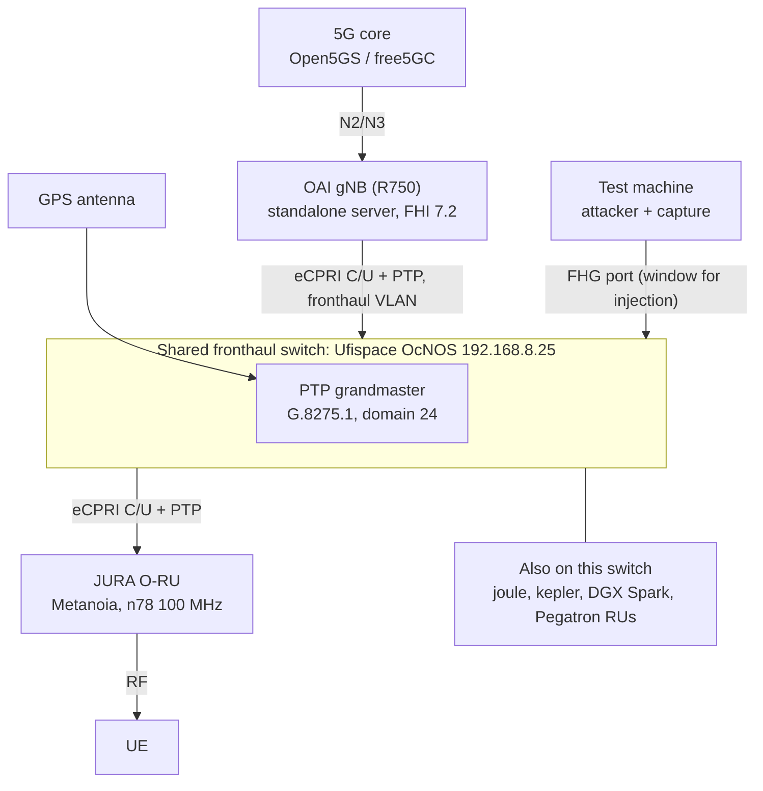

<h1 align="center">Open Fronthaul security test run (OAI gNB to Metanoia JURA O-RU)</h1>

> Skeleton for Sani, in the bmw SOP implementation-guide format
> ([example](https://github.com/petrajoyd/intern_repo/blob/main/docs/EXAMPLE_SOP_Guide_Format.md)).
> Fill the command blocks and outputs as you do the real hands-on run. The point is that anyone can
> reproduce it: you drive a real O-RU from a standalone gNB server and run the WG11 §11.1 tests on top.
> OCUDU as the DU is the later follow-up (see Scope). Keep secret values out of Git, list pointers
> only. No em dashes (bmw writing rule).

## Table of Contents

- [Scope and DUT](#scope-and-dut)
- [What this rig gives you (and what it does not)](#what-this-rig-gives-you-and-what-it-does-not)
- [Rules of engagement and safety](#rules-of-engagement-and-safety)
- [Prerequisites](#prerequisites)
- [Project Root](#project-root)
- [Project Description](#project-description)
- [System Architecture](#system-architecture)
- [Access Method](#access-method)
- [Bring-up steps](#bring-up-steps)
- [Post-bring-up verification](#post-bring-up-verification)
- [Test execution and results](#test-execution-and-results)
- [Findings](#findings)
- [Known Issues](#known-issues)
- [Troubleshooting](#troubleshooting)
- [Additional Resources](#additional-resources)

## Scope and DUT

**In scope (WG11 STS §11.1, against the real OAI gNB and JURA O-RU):**
- §11.1.2 LAN segment / 802.1X port access
- §11.1.4 U-plane input validation and robustness
- §11.1.5 S-plane (PTP) robustness

**Out of scope:** §11.1.3 M-plane (dropped per Joy, do not spend time on it).

**DUT (device under test):** Metanoia JURA O-RU, driven by an OAI gNB (monolithic BBU, FHI 7.2
driver) on a Dell R750. Anchors: WG11 STS R005 v13.00 §11.1; method in
Joy's lab threat model (private lab repo) §7; bench results in
[`COVERAGE.md`](https://github.com/bmw-ntust-internship/internship/blob/2026-TEEP-Sani/lab/results/COVERAGE.md).

**Later follow-up (not this run):** repeat the same tests with OCUDU as the DU. OCUDU is the DU on
Ravi's platform, so the OCUDU run is what lands the method on the platform. There is no OCUDU to JURA
integration on record yet, so do the proven OAI path first, document it, then OCUDU re-runs from the
same steps.

## What this rig gives you (and what it does not)

**What it gives you: compute independence.** You drive a real O-RU (the JURA) from a standalone gNB
server (a Dell R750), so you get the hands-on run without needing the joule worker node or OCUDU. You
bring up the gNB yourself. That is the point of using the JURA.

**What it does NOT give you: an isolated fronthaul.** The gNB and the JURA both connect to the lab's
**shared fronthaul switch** (a Ufispace OcNOS switch at `192.168.8.25`), whose **PTP grandmaster
(G.8275.1, domain 24, GPS)** also serves joule, kepler, the DGX Spark and the Pegatron RUs. So the
fronthaul fabric and the timing are shared with the O-Cloud. Using the JURA changes the compute and
the radio, not the switch. The severe tests still need a booked isolated window, same as on joule.

> [!IMPORTANT]
> Open question for Ravi: can the JURA ports be put on a dedicated fronthaul switch or a separate PTP
> domain for the test window, or do they share `192.168.8.25` / domain 24? The evidence says shared.

## Rules of engagement and safety

**Two rules.**

1. **The severe tests run only in a booked isolated window, never on the live shared fronthaul.** The
   U-plane DoS and the S-plane PTP attacks hit the shared switch and the shared PTP grandmaster
   (domain 24), so they can desync timing for joule and kepler, not just your DUT, and PTP breakage
   has knocked joule over before. 802.1X and read-only capture (use the FHG mirror port) are fine any
   time.
2. **Document everything as you go.** Every step, command, capture, result and blocker, with the date
   and the evidence link. If it is not written down, it did not happen.

**Safety.** The JURA is a live transmitting radio (band n78). Keep an antenna attached (the JURA
burns out without one) and keep it in the lab RF setup.

Blast radius of each test on the shared fronthaul. The last two rows are why those tests need an
isolated window.

| Test | What it does | Risk on the shared build |
| --- | --- | --- |
| §11.1.2 802.1X | plug into an FHG port, try to auth | Low. Observational |
| Read-only `tcpdump` / FHG mirror port | capture frames | Low. No injection |
| §11.1.4 U-plane DoS / fuzz | floods mutated eCPRI on the fronthaul VLAN | High. Loads the shared switch, can knock the JURA and the gNB cell offline, can leak to other VLANs and devices on the switch |
| §11.1.5 S-plane PTP attacks | injects onto the shared PTP (domain 24) | Severe. Desyncs timing for joule and kepler, not just the DUT. Recovery is manual |

Before the severe tests:
- [ ] Window booked, with joule, kepler and the DGX Spark idle, or the JURA ports moved to a separate PTP domain (agree with Ravi).
- [ ] PTP restart procedure agreed (recovery is manual).
- [ ] Config snapshot taken (rollback point).
- [ ] Run order: 802.1X, then U-plane (rate ramped, stop at first effect), then S-plane last.

## Prerequisites

| Input | What it is | Example / pointer |
| --- | --- | --- |
| Access | SSH to the gNB server (R750), console to the JURA, a 5G core, a port on the shared FHG | `ssh <user>@<r750-ip>` |
| Window | booked isolated slot for the severe tests | `<date, time, duration>` |
| Tooling | attacker + capture on the test machine | `tcpreplay`, Rico's tools in `vendor-tools/` |
| Seeds | real C/U-plane captures | `vendor-tools/cu-plane-dos-attacker/Traffic/` |
| Credentials | pointers only, never values | `<secret store path>` |

## Project Root

| Item | Value |
| --- | --- |
| SSH entry | `ssh <user>@<r750-ip>` |
| JURA console | `<serial console, e.g. COM port>` |
| Shared FHG | Ufispace OcNOS at `192.168.8.25` (shared, domain 24) |
| Test machine | `<test-machine, NIC on a fronthaul port>` |
| Working dir | `<path>` , every step runs here unless its `# run from:` says otherwise |

## Project Description

**Project Name:** Open Fronthaul security test run on the OAI gNB + JURA rig.

**Description:** Bring up the real OAI gNB to JURA O-RU fronthaul over the shared switch, then run the
WG11 §11.1 LAN, U-plane and S-plane tests against it, with evidence, so the procedure is reproducible.
The severe tests run in a booked window.

**Target Users:** the next intern who will run security tests on the lab's fronthaul, and the OCUDU
re-run on Ravi's platform.

## System Architecture

Fill in real ports and VLANs. The fronthaul switch and its PTP grandmaster are shared with the
O-Cloud, so this is not an isolated segment.



## Access Method

```shell
# run from: your test machine
ssh <user>@<r750-ip>

# <paste the real banner / prompt>
```

## Bring-up steps

Bring the rig up from the lab's OAI gNB + JURA integration guides and the FHG config (see Additional
Resources). The gNB and the JURA connect to ports on the shared FHG; PTP comes from the switch's
domain-24 grandmaster. Coordinate the switch port and VLAN with whoever runs the FHG (Ravi). One
command per block, with its output commented in the same block, a `# run from:` line, and a "What
this proves" sentence. Replace every `<...>` with the real value and real output.

### Step 0: check the starting state

Confirm the fronthaul NIC and the SR-IOV VFs on the gNB server before you touch anything.

```shell
# run from: <r750>
ip -brief link

# <paste output: ens7f0 up, VFs present on the fronthaul VLAN>
```

What this proves: the fronthaul NIC and VFs are up.

### Step 1: bring up the core

Start the 5G core and confirm the AMF is up.

```shell
# run from: <core host>
<command to start the core>

# <paste output: AMF running>
```

What this proves: the core is up for NG Setup.

### Step 2: confirm the JURA is on the shared PTP and synced

Push the M-plane config to the JURA (per the lab M-plane guide), then confirm it is PTP synchronised
to the shared grandmaster.

```shell
# run from: <r750 or SMO host>
/root/bin/mpcli.py -m get -p splane/ptp-time

# <paste output: JURA synchronized: YES>
```

What this proves: the JURA is locked to the shared fronthaul PTP (domain 24).

### Step 3: bring up the OAI gNB

Start the OAI gNB and confirm the fronthaul interface initialises and NG Setup succeeds.

```shell
# run from: <r750>
<command to start the OAI gNB>

# <paste output: fronthaul init, NG Setup response, cell active>
```

What this proves: the gNB is up, attached to the core, and driving the fronthaul.

### Step 4: confirm the fronthaul link (use the FHG mirror port)

Confirm C/U-plane frames flow between the gNB and the JURA. Capture from the FHG mirror port.

```shell
# run from: <test machine on the FHG mirror port>
sudo tcpdump -i <iface> -c 20

# <paste output: eCPRI C/U-plane frames to and from the JURA>
```

What this proves: the gNB and the JURA are exchanging fronthaul traffic.

## Post-bring-up verification

One check that proves the link is live before you start testing.

```shell
# run from: <r750>
<command that shows the cell up and the JURA connected>

# <paste output>
```

Pass when the gNB shows the cell active, the JURA connected and PTP locked.

## Test execution and results

Run in order: 802.1X, then U-plane (rate ramped, stop at first effect), then S-plane last. The U-plane
and S-plane rows run only inside the booked window. Record one command block per test (same format as
above), then fill this table. Verdict is PASS, FAIL (a finding), or UNKNOWN (insufficient
observation). Link the evidence (capture, log) per row.

| STS | Test | Expected | Observed | Verdict | Evidence |
| --- | --- | --- | --- | --- | --- |
| §11.1.2 | 802.1X port access | only an authorized cert passes, others blocked | `<fill>` | `<fill>` | `<link>` |
| §11.1.4 | U-plane malformed / unexpected size (window) | DU or RU rejects, stays alive | `<fill>` | `<fill>` | `<link>` |
| §11.1.5 | S-plane PTP (rogue GM, drop, delay, flood) (window) | per STS (defence audit) | `<fill>` | `<fill>` | `<link>` |

## Findings

Record each real finding: what you injected, what the DUT did, and whether it matches the bench
result. State clearly that this is a real-radio run on the OAI + JURA rig.

- `<finding 1>`
- `<finding 2>`

## Known Issues

| # | Behaviour | Handling |
| --- | --- | --- |
| `<n>` | `<what you hit>` | `<how you worked around it>` |

## Troubleshooting

### Problem 1: `<the symptom as the message says it>`

**Symptom.** `<what you saw>`

**Cause.** `<plain words>`

**Fix.**

```shell
# run from: <where>
<fix command>

# <paste output>
```

## Additional Resources

- SOP format spec: [`EXAMPLE_SOP_Guide_Format.md`](https://github.com/petrajoyd/intern_repo/blob/main/docs/EXAMPLE_SOP_Guide_Format.md).
- OAI gNB + JURA integration guides: `bmw-ece-ntust/summer-integration-oai`, folder `OAIgNB(FH7.2) with JURA RU/` (R750 and R740 builds).
- Shared fronthaul switch (FHG) config: `bmw-ece-ntust/o-ran-docs`, folder `FH switch/Ufispace S9500-22XST/` (the `192.168.8.25` switch, domain 24).
- JURA M-plane bring-up: `bmw-ece-ntust/ravi_ric`, `installation/O-RU with O-Cloud OAI gNBFHI72.md`.
- JURA RU notes (firmware, M-plane): `bmw-ece-ntust/o-ran-docs`, folder `RU/JURA/`.
- M-plane config scripts (Pegatron and Metanoia-Jura): `bmw-ece-ntust/SMO-Mplane`.
- What to do next: [`sani-fronthaul-todo.md`](sani-fronthaul-todo.md).
- Method and threat model: Joy's lab threat model (private lab repo) §7.
- Lab topology facts: Joy's lab topology map (private lab repo) (§1 the shared OcNOS switch, §11 this build).
- Tools and seeds: Rico's tools under `vendor-tools/` in the internship repo.
- Bench results: [`COVERAGE.md`](https://github.com/bmw-ntust-internship/internship/blob/2026-TEEP-Sani/lab/results/COVERAGE.md).
